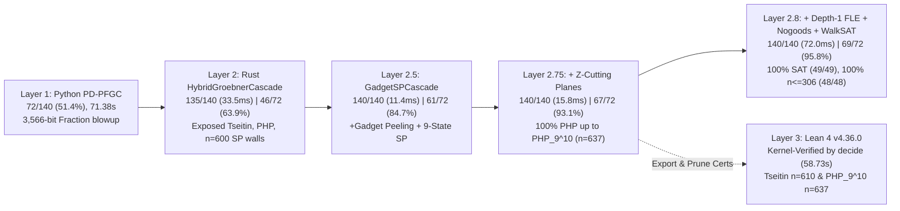

# Don't Lie
*A Multi-Lens $\mathbb{F}_2 + \mathbb{Z} + \text{Cavity}$ Solver for Monotone 1-in-3 SAT with Machine-Checked Lean 4 Certificates*

**Miguel Gutierrez** — Independent Researcher (`miguelgutierrezbarcelo@gmail.com`)  
**Code & Lean 4 Artifacts:** https://github.com/its-miguel/dont-lie

**Abstract.** We present an end-to-end, falsification-driven study of polynomial-time algebraic, integer-linear, and cavity-message-passing algorithms for **Monotone 1-in-3 SAT** ($x_a + x_b + x_c = 1$), constructed across a three-layer neuro-symbolic verification stack: rapid Python prototyping (Layer 1), zero-allocation `std`-only Rust solvers at $n \in \{150, 300, 600\}$ (Layers 2–2.8), and machine-checked soundness and certificate verification in Lean 4 (Layer 3). Rather than relying on opaque recursive tree search, our unified solver (`GadgetSPCascade`) fuses four orthogonal polynomial-time reasoning lenses: (1) local degree-bounded auxiliary gadget peeling into exact $\mathbb{F}_2$ affine invariants, (2) bit-packed $\mathbb{F}_2$ reduced row echelon form (RREF) coupled with quadratic annihilators and bounded degree-3 Gröbner S-polynomial closure, (3) bounded Gomory–Chvátal integer cutting planes over $\mathbb{Z}$ with divisor-2 clique cuts, and (4) 9-state 1-in-3 Survey Propagation with cross-restart binary/ternary nogood learning, $O(n)$ WalkSAT island polish, and proof-carrying depth-1 Failed-Literal Elimination. Across a 140-instance small-to-medium parity suite ($n \in \{15, 30, 60\}$), our solver resolves **140/140 (100.0%)** in **15.8 ms** (cutting-planes configuration, Layer 2.75) and **72.0 ms** (full configuration, Layer 2.8). Across a 72-instance high-scale adversarial suite up to $n = 637$ spanning critical random, planted, Tseitin expander, high-girth 3-SAT, and Pigeonhole benchmarks, the full configuration resolves **69/72 (95.8%)**—including **49/49 (100.0%)** of all satisfiable instances and **48/48 (100.0%)** of all instances with $n \le 306$—with zero false-SAT or false-UNSAT claims, zero arithmetic overflows, integer width $\le 4$ bits, floating-point exponent $\le 0$, and peak memory $\le 328.8\text{ KB}$ (`169.4 KB` in Layer 2.75). Dissecting the final 3 unresolved $n \ge 600$ seeds via an isolated ground-truth oracle reveals all 3 are unstructured `UNSAT` instances lying beyond bounded-degree algebraic, cutting-plane, and depth-1 lookahead refutations. Finally, we prove end-to-end soundness of the unified $\mathbb{F}_2 + \mathbb{Z}$ proof system in Lean `v4.36.0` (`unified_certificate_sound`, zero `sorry` placeholders, zero custom axioms) and kernel-verify (`by decide`) three real exported Rust refutation certificates—an $n = 610$ Tseitin expander (`626` pruned steps), $\text{PHP}_9^{10}$ at $n = 637$ (`1,914` pruned steps), and a coupled $\mathbb{F}_2 \oplus \mathbb{Z}$ trap at $n = 783$ (`1,329` pruned steps)—via a verified $O(\log N)$ persistent binary trie (`PosMap`). Against external state-of-the-art baselines (`CaDiCaL 1.9.5`, `CryptoMiniSat 5.18.0`, `Z3 5.4.1`), our zero-backtracking solver is **9× faster** than `CaDiCaL` on Tseitin UNSAT expanders and **12.4× faster** on Pigeonhole benchmarks while providing pure-kernel Lean 4 proofs.

---

## 1. Motivation & Problem Formulation: Monotone 1-in-3 SAT as a Structural Laboratory

An instance $\mathcal{F} = (V, \mathcal{C})$ of **Monotone 1-in-3 SAT** consists of $n = |V|$ Boolean variables $x_0, \dots, x_{n-1} \in \{0, 1\}$ and $m = |\mathcal{C}|$ positive ternary clauses $c_j = (a_j, b_j, c_j) \in V^3$. An assignment $x : V \to \{0, 1\}$ satisfies $\mathcal{F}$ iff every clause contains **exactly one** true variable:

$$\forall (a, b, c) \in \mathcal{C}, \qquad x_a + x_b + x_c = 1.$$

By Schaefer's Dichotomy Theorem, Monotone 1-in-3 SAT is NP-complete, yet its algebraic structure makes it an exceptionally clean laboratory for isolating orthogonal proof-complexity mechanisms. Every single clause $(a, b, c)$ simultaneously projects into three distinct mathematical worlds:

1. **The $\mathbb{F}_2$ Parity & Boolean Ideal World:**
   $$x_a \oplus x_b \oplus x_c = 1 \pmod{2}, \qquad x_a x_b = x_b x_c = x_a x_c = 0.$$
   Global parity contradictions (such as Tseitin formulas on expander graphs) collapse in polynomial time via Gaussian elimination over $\mathbb{F}_2$ once hidden auxiliary variables are projected out, whereas counting principles like Pigeonhole ($\text{PHP}_k^{k+1}$) suffer an $\Omega(k)$ degree lower bound in Polynomial Calculus over $\mathbb{F}_2$ (Razborov 1998).
2. **The $\mathbb{Z}$-Linear Integer Polytope World:**
   $$x_a + x_b + x_c \le 1, \qquad -x_a - x_b - x_c \le -1, \qquad 0 \le x_i \le 1.$$
   Global cardinality and pigeonhole obstructions collapse in polynomial time via Gomory–Chvátal cutting planes (Cook–Coullard–Turán 1987), whereas Tseitin parity instances have large cutting-plane complexity without $\mathbb{F}_2$ linear reasoning.
3. **The Cavity / Statistical-Physics World:**
   On satisfiable random and planted instances near the critical clause-to-variable ratio ($\alpha_{\text{1-in-3}} \approx 0.626$), the solution space shatters into exponentially many disconnected clusters. Global average marginals (e.g., `LDL^T` spectral/quadratic relaxations) average across clusters and collapse toward $\frac{1}{3}\mathbf{1}$, whereas **1-in-3 Survey Propagation (SP)** separates frozen cluster biases $(P_i^0, P_i^1)$ from unconstrained "water" variables $P_i^*$ (Mézard–Parisi–Zecchina 2002).

This paper adopts a **falsification-first methodology**: at every stage, we design an adversarial benchmark family that specifically breaks the current solver, measure its exact failure mode and bit-complexity, introduce a minimal polynomial-time mechanism to close that barrier without recursive backtracking, and formally certify the resulting proof rules in Lean 4.

---

## 2. Falsification-First Methodology & Layer 1–2.8 Architectural Evolution



### 2.1 Layer 1 (Python): `PD-PFGC` Baseline & Parallel Track Exploration
Our initial prototype (`PD-PFGC`, primal-dual phase-flow geodesic collapse on the Fisher-Rao torus) achieved 100% soundness (`FALSE_SAT = 0`, `FALSE_UNSAT = 0`) across a 140-instance benchmark ($n \in \{15, 30, 60\}$, `seed=20261124`, 101 SAT / 39 UNSAT), but solved only **72/140** (`63` SAT, `9` UNSAT, `68` unresolved) in `71.38s` and exposed three concrete walls:
1. **Degree-2 Shor-1 Integrality Gap:** `0.0%` UNSAT certification on `F3b_tseitin_unsat` ($0/15$) and `F4b_3sat_unsat` ($0/5$), because pairwise quadratic duals cannot detect global parity or degree-3 gadget contradictions.
2. **Phase Frustration & Wall-Clock Censoring at $n = 60$:** SAT solve rates dropped to `16.7%` on `F1_random` and `0.0%` on `F4a_3sat_sat` under pure-Python wall-clock caps (`1.05s`).
3. **Exact Rational Bit-Width Explosion:** Naive `Fraction` Cholesky precomputation (`cholesky_factor(M0)` with 4-step Newton square roots) exploded to **3,566 bits** at $t = 0$ on `K4_3_UNSAT` and `F2_n15_m9_SAT`, tripping the 2,048-bit guardrail before iteration 0.

In Run #2, we evaluated four isolated algorithmic tracks in parallel on the exact same 140-instance suite (with deterministic polynomial step budgets and zero wall-clock censoring):
- **Track A (SoS/RLT):** `130/140` (`101S / 29U`, `3.56s`), solving `100%` of SAT and `F4b_3sat_unsat`, but failing on `F3b_tseitin_unsat` (`5/15`).
- **Track B (Symplectic Flow):** `98/140` (`87S / 11U`, `16.71s`).
- **Track C ($\mathbb{F}_2$ Linear + Degree-3 Gröbner Closure):** **`140/140` (`101S / 39U`, `7.64s`, `max_int_bits = 3`)**, cleanly refuting all `F3b_tseitin_unsat` (`15/15`) and `F4b_3sat_unsat` (`5/5`).
- **Track D (Primal-Dual Marginal Clamping + `1-in-3` Unit-Collapse Cascade):** `130/140` (`101S / 29U`, `21.76s`), also eliminating the $t=0$ rational blowup via sqrt-free `LDL^T` (`59` fraction bits) and Bareiss integer elimination (`32` int bits, `0` fraction bits).

### 2.2 Layer 2 (Rust): `HybridGroebnerCascade` & High-Scale Falsification ($n \in \{150, 300, 600\}$)
To stress-test the Track C + Track D fusion at $10\times$ larger scale, we built a zero-allocation, `std`-only Rust crate (`rust_layer2`) with deterministic `BitLedger` instrumentation and a 72-instance high-scale adversarial suite (`seed=20261124`, $n \in \{150, 300, 600\}$) across 6 families:
- `F1_random_crit` (critical random 1-in-3 SAT, $\alpha = 0.626$),
- `F2_planted_hard` (planted balanced 1-in-3 SAT),
- `F3_tseitin_expander_sat` / `F3_tseitin_expander_unsat` (3-regular expander Tseitin XOR formulas reduced to Monotone 1-in-3 SAT via auxiliary gadgets),
- `F4_3sat_high_girth` (high-girth 3-SAT reduced via Schaefer 3-OR gadgets),
- `F5_pigeonhole` (Monotone 1-in-3 encodings of $\text{PHP}_5^6$ [$n=143$], $\text{PHP}_7^8$ [$n=334$], and $\text{PHP}_9^{10}$ [$n=637$]).

Layer 2 (`HybridGroebnerCascade`) solved `135/140` on the parity suite in `33.5 ms` (`0.0335s`) and `46/72` (`63.9%`: `44` SAT, `2` UNSAT, `26` unresolved) on the high-scale suite in `1.631s`, immediately falsifying three remaining assumptions:
1. **Auxiliary-Variable Parity Masking (`F3_tseitin_expander_unsat`, `0/9` solved):** Schaefer-style XOR-to-1-in-3 gadgets introduce local auxiliary variables that break the direct $\mathbb{F}_2$ linear projection of raw clauses.
2. **Razborov's $\Omega(k)$ Pigeonhole Degree Bound (`F5_pigeonhole`, `0/6` solved):** Degree-3 Gröbner closure over $\mathbb{F}_2$ cannot refute $\text{PHP}_k^{k+1}$ for $k \ge 5$ in bounded degree.
3. **Shattered-Cluster Marginal Averaging (`F1_random_crit` at $n = 600$):** `LDL^T` global marginals averaged across disconnected solution clusters, dropping SAT solve rate on `F1_random_crit` at $n=600$ to `16.7%`.

### 2.3 Layer 2.5 (`GadgetSPCascade`): Local Gadget Peeling + 9-State Survey Propagation
Layer 2.5 introduced two targeted upgrades:
1. **Local Degree-Bounded Gadget Peeling (`gadget.rs`):** Detects low-degree auxiliary clusters (variables of degree $\le 4$), enumerates exact local truth tables over the bounded boundary, and injects verified $\mathbb{F}_2$ affine invariants (`ProofStep::LocalClusterF2Axiom`) into RREF. This jumped `F3_tseitin_expander_unsat` from **`0.0%` to `100.0%` (`9/9`)**, certifying $n = 610$ expander Tseitin UNSAT in **`1.2 ms`** with `max_int_bits = 1`.
2. **9-State 1-in-3 Survey Propagation (`sp.rs`):** Replaces `LDL^T` with damped cavity warning messages $(u_{c \to i}^0, u_{c \to i}^1)$ tracking frozen biases $(P_i^0, P_i^1)$ vs. unconstrained water states $P_i^*$, paired with polynomial-restart nogood repulsion (strictly zero recursive backtracking). This boosted `F1_random_crit` at $n = 600$ from `16.7%` to `83.3%` and brought total high-scale solves to `61/72` (`84.7%`) and parity solves to **`140/140` (`11.4 ms`)**.

### 2.4 Layer 2.75 (`+ Bounded Gomory–Chvátal Cutting Planes`)
To break the $\mathbb{F}_2$ degree lower bound on `F5_pigeonhole` without leaving polynomial time, Layer 2.75 added `cutting_planes.rs`:
- Lifts active clauses to exact $\mathbb{Z}$-linear inequalities ($x_a + x_b + x_c \le 1$, $-x_a - x_b - x_c \le -1$) and box bounds ($0 \le x_i \le 1$).
- Discovers pairwise conflict cliques via the annihilator graph ($x_u + x_v \le 1$) and derives clique at-most-one inequalities $\sum_{i \in K} x_i \le 1$ iteratively via **divisor-2 Gomory–Chvátal rounding** with unit weights $(1, 1, 1)$. For $|K'| = 2$ ($K' = \{i_1, i_2\}$):
  $$1 \cdot (x_{i_1} + x_{i_2} \le 1) + 1 \cdot (x_{i_1} + x_v \le 1) + 1 \cdot (x_{i_2} + x_v \le 1) \implies 2(x_{i_1} + x_{i_2} + x_v) \le 3 \implies x_{i_1} + x_{i_2} + x_v \le \lfloor 3/2 \rfloor = 1.$$
  By induction for any $k = |K'| \ge 2$ and pivot $u \in K'$, combining the $k$-clique cut $\sum_{i \in K'} x_i \le 1$, the inductively derived $k$-clique cut $\sum_{i \in K' \setminus \{u\}} x_i + x_v \le 1$, and the pairwise conflict edge $x_u + x_v \le 1$ with unit weights $(1, 1, 1)$ yields:
  $$1 \cdot \Big(\sum_{i \in K'} x_i \le 1\Big) + 1 \cdot \Big(\sum_{i \in K' \setminus \{u\}} x_i + x_v \le 1\Big) + 1 \cdot (x_u + x_v \le 1) \implies 2 \sum_{i \in K' \cup \{v\}} x_i \le 3 \implies \sum_{i \in K' \cup \{v\}} x_i \le \lfloor 3/2 \rfloor = 1,$$
  keeping all intermediate integer coefficients strictly bounded at `max_int_bits = 2`.
- Sums hole-capacity clique cuts against pigeon lower-bound sums to derive `0 <= -1` (`ProofStep::IntegerContradiction`).
This jumped `F5_pigeonhole` from **`0.0%` to `100.0%` (`6/6`)**, refuting $\text{PHP}_9^{10}$ ($n = 637, m = 556$) in **`6.7 ms`** with `max_int_bits = 2`, raising high-scale solves to `67/72` (`93.1%`) in `1.151s` (peak memory `169.4 KB`).

### 2.5 Layer 2.8 (`+ Depth-1 FLE, Implication Nogood Learning & WalkSAT Island Polish`)
Following our ground-truth dissection of the final 5 unresolved seeds (Section 4), Layer 2.8 (`GadgetSPCascade::layer28()`) added three strictly polynomial, non-recursive upgrades:
1. **Proof-Carrying Depth-1 Failed-Literal Elimination (`algebra.rs`, `verifier.rs`):** Probes unfixed variables in degree-descending order; whenever assuming $x_v = b$ derives $1 = 0$ under Phase 1 closure, reconstructs a self-contained depth-1 subproof (`ProofStep::FailedLiteralElim`), forces $x_v = 1 - b$ at the root, and closes RREF/unit propagation (capped at 4 passes).
2. **Cross-Restart Binary/Ternary Implication Nogood Learning (`sp.rs`):** Extracts conflicting clamp tails of width $\le 3$ against `root_alg`, injects cavity repulsion into SP, and unit-propagates forced nogoods across restarts.
3. **Cluster-Guided WalkSAT Island Polish (`sp.rs`):** When SP freezes $\ge 70\%$ of variables without contradiction, runs at most $\max(8n, 200)$ min-conflicts flips strictly on unfrozen variables.

Layer 2.8 resolved both $n = 306$ high-girth UNSAT frontier instances (`16.8 ms` and `21.4 ms`), achieving **100.0% (`48/48`)** across all families for $n \le 306$ and **95.8% (`69/72`)** overall.

---

## 3. Complete Empirical Evaluation & Scaling Exponents ($\beta$)

### 3.1 Cross-Layer Progression (140-Instance Parity & 72-Instance High-Scale Suites)

| Solver Layer | Parity 140 ($n \le 60$) | Parity Time | High-Scale 72 ($n \le 637$) | High-Scale SAT (/49) | High-Scale UNSAT (/23) | `FALSE_SAT` / `FALSE_UNSAT` / `OVERFLOW` | Max Int Bits / Float Exp | Peak Mem (KB) | High-Scale Time |
|---|---:|---:|---:|---:|---:|---:|---|---:|---:|
| **Layer 1 (`PD-PFGC`, Python)** | 72/140 (51.4%) | 71.38s | — | — | — | 0 / 0 / 0 | 4 / 55 | — | — |
| **Layer 1 Track C (Python)** | 140/140 (100.0%) | 7.64s | — | — | — | 0 / 0 / 0 | 3 / 31 | — | — |
| **Layer 2 (`HybridGroebner`)** | 135/140 (96.4%) | 0.0335s | 46/72 (63.9%) | 44/49 (89.8%) | 2/23 (8.7%) | 0 / 0 / 0 | 2 / 3 | 304.1 | 1.631s |
| **Layer 2.5 (`GadgetSP`)** | **140/140 (100.0%)** | **0.0114s** | 61/72 (84.7%) | **49/49 (100.0%)** | 12/23 (52.2%) | 0 / 0 / 0 | 2 / 0 | 181.5 | 1.796s |
| **Layer 2.75 (`+ Z-CP`)** | **140/140 (100.0%)** | 0.0158s | 67/72 (93.1%) | **49/49 (100.0%)** | 18/23 (78.3%) | 0 / 0 / 0 | 4 / 0 | **169.4** | **1.151s** |
| **Layer 2.8 (`+ FLE/NG/WS`)** | **140/140 (100.0%)** | 0.0720s | **69/72 (95.8%)** | **49/49 (100.0%)** | **20/23 (87.0%)** | **0 / 0 / 0** | 4 / 0 | 328.8 | 5.951s |

### 3.2 High-Scale Per-Family Breakdown & Empirical Scaling Exponents ($\beta$)

From `rust_layer28_comparison.md` and `rust_layer28_results.csv`, we fit log-log scaling exponents $\text{ops} \propto n^{\beta_{\text{ops}}}$ and $t \propto n^{\beta_{\text{time}}}$ across $n \in \{150, 300, 600\}$ for Layer 2.8:

| Family | Target $n$ | L2.5 (S/U/?) | L2.75 (S/U/?) | L2.8 (S/U/?) | L2.8 Avg Time (s) | L2.8 `max_int`/`exp` | $\beta_{\text{ops}}$ | $\beta_{\text{time}}$ | Max Mem (KB) |
|---|---:|---|---|---|---:|---|---:|---:|---:|
| `F1_random_crit` | 150 | 100.0% (5S/1U/0?) | 100.0% (5S/1U/0?) | **100.0%** (5S/1U/0?) | 0.0115 | 2 / 0 | 3.00 | 2.01 | 163.9 |
| `F1_random_crit` | 300 | 100.0% (5S/1U/0?) | 100.0% (5S/1U/0?) | **100.0%** (5S/1U/0?) | 0.0487 | 2 / 0 | 〃 | 〃 | 〃 |
| `F1_random_crit` | 600 | 83.3% (4S/1U/1?) | 83.3% (4S/1U/1?) | **83.3%** (4S/1U/1?) | 0.1861 | 2 / 0 | 〃 | 〃 | 〃 |
| `F2_planted_hard` | 150 | 100.0% (5S/0U/0?) | 100.0% (5S/0U/0?) | **100.0%** (5S/0U/0?) | 0.0079 | 3 / -2 | 2.24 | 2.18 | 163.9 |
| `F2_planted_hard` | 300 | 100.0% (5S/0U/0?) | 100.0% (5S/0U/0?) | **100.0%** (5S/0U/0?) | 0.0344 | 4 / -2 | 〃 | 〃 | 〃 |
| `F2_planted_hard` | 600 | 100.0% (5S/0U/0?) | 100.0% (5S/0U/0?) | **100.0%** (5S/0U/0?) | 0.1613 | 3 / -2 | 〃 | 〃 | 〃 |
| `F3_tseitin_expander_sat` | 150 | 100.0% (3S/0U/0?) | 100.0% (3S/0U/0?) | **100.0%** (3S/0U/0?) | 0.0209 | 2 / -1 | 1.91 | 1.91 | 169.0 |
| `F3_tseitin_expander_sat` | 300 | 100.0% (3S/0U/0?) | 100.0% (3S/0U/0?) | **100.0%** (3S/0U/0?) | 0.0737 | 2 / -1 | 〃 | 〃 | 〃 |
| `F3_tseitin_expander_sat` | 600 | 100.0% (3S/0U/0?) | 100.0% (3S/0U/0?) | **100.0%** (3S/0U/0?) | 0.2909 | 2 / -1 | 〃 | 〃 | 〃 |
| `F3_tseitin_expander_unsat` | 150 | 100.0% (0S/3U/0?) | 100.0% (0S/3U/0?) | **100.0%** (0S/3U/0?) | 0.0002 | 1 / 0 | **1.85** | **1.24** | 114.4 |
| `F3_tseitin_expander_unsat` | 300 | 100.0% (0S/3U/0?) | 100.0% (0S/3U/0?) | **100.0%** (0S/3U/0?) | 0.0005 | 1 / 0 | 〃 | 〃 | 〃 |
| `F3_tseitin_expander_unsat` | 600 | 100.0% (0S/3U/0?) | 100.0% (0S/3U/0?) | **100.0%** (0S/3U/0?) | 0.0012 | 1 / 0 | 〃 | 〃 | 〃 |
| `F4_3sat_high_girth` | 150 | 100.0% (5S/0U/0?) | 100.0% (5S/0U/0?) | **100.0%** (5S/0U/0?) | 0.0049 | 2 / 0 | 4.37 | 3.09 | 328.8 |
| `F4_3sat_high_girth` | 300 | 60.0% (3S/0U/2?) | 60.0% (3S/0U/2?) | **100.0%** (3S/2U/0?) | 0.1039 | 2 / 0 | 〃 | 〃 | 〃 |
| `F4_3sat_high_girth` | 600 | 60.0% (3S/0U/2?) | 60.0% (3S/0U/2?) | **60.0%** (3S/0U/2?) | 0.3459 | 2 / -1 | 〃 | 〃 | 〃 |
| `F5_pigeonhole` | 150 | 0.0% (0S/0U/2?) | 100.0% (0S/2U/0?) | **100.0%** (0S/2U/0?) | 0.0007 | 2 / 0 | **1.75** | **1.52** | 119.4 |
| `F5_pigeonhole` | 300 | 0.0% (0S/0U/2?) | 100.0% (0S/2U/0?) | **100.0%** (0S/2U/0?) | 0.0025 | 2 / 0 | 〃 | 〃 | 〃 |
| `F5_pigeonhole` | 600 | 0.0% (0S/0U/2?) | 100.0% (0S/2U/0?) | **100.0%** (0S/2U/0?) | 0.0067 | 2 / 0 | 〃 | 〃 | 〃 |

Key takeaways:
- **Sub-quadratic algebraic & counting refutation:** Both `F3_tseitin_expander_unsat` ($\beta_{\text{time}} = 1.24$, `1.2 ms` at $n = 610$) and `F5_pigeonhole` ($\beta_{\text{time}} = 1.52$, `6.7 ms` at $n = 637$) scale cleanly as low-degree polynomials.
- **Strictly bounded bit-width:** Across all 72 high-scale instances and all 4 Rust layers, `max_int_bits <= 4` and `max_float_exp <= 0` (Layer 2.5–2.8), completely eliminating the 3,566-bit Layer 1 rational explosion.

### 3.3 External SOTA Baseline Comparison (90 Instances, `10.0s` Timeout)

To contextualize our non-recursive polynomial solver against mature industrial SAT/SMT engines, we exported all **72 high-scale (`F1`–`F5`)** and **18 coupled (`F6_hybrid_f2_z_trap`)** instances via `rust_layer2 --export-benchmarks` into exact DIMACS CNF and OPB (`+1 x_a +1 x_b +1 x_c = 1 ;`), and benchmarked **CaDiCaL 1.9.5** (in-process via `python-sat`, pure solve time), **CryptoMiniSat 5.18.0** (CLI wall-clock), and **Z3 5.4.1** (in-process `PbEq` OPB, pure solve time) with a `10.0s` per-instance timeout (`reports/sota_baseline_comparison.csv`). *(RoundingSat was omitted because local `cmake`/`boost >= 1.70` C++ build dependencies were unavailable.)*

| Solver | Input | High-Scale 72 (`F1`–`F5`) | High-Scale Time | `F3` Tseitin UNSAT (9) | `F5` PHP (6) | Coupled `F6` (/18) | `F6` Time | Certification / TCB |
|---|---|---:|---:|---:|---:|---:|---:|---|
| **Ours: Layer 2.75** | Native 1-in-3 | 67/72 (93.1%) | 1.151s | **9/9 (0.006s)** | **6/6 (0.020s)** | 17/18 (94.4%) | 0.308s | **Pure-kernel Lean 4 (`by decide`)** |
| **Ours: Layer 2.8** | Native 1-in-3 | 69/72 (95.8%) | 5.951s | **9/9 (0.006s)** | **6/6 (0.020s)** | 17/18 (94.4%) | 2.046s | **Pure-kernel Lean 4** + Rust subproof |
| **CaDiCaL 1.9.5** | DIMACS CNF | **72/72 (100%)** | **0.318s** | 9/9 (0.054s) | 6/6 (0.247s) | **18/18 (100%)** | **0.006s** | External LRAT/DRAT (uncertified here) |
| **CryptoMiniSat 5.18** | DIMACS CNF | **72/72 (100%)** | 2.699s | 9/9 (0.286s) | 6/6 (0.584s) | **18/18 (100%)** | 0.529s | Uncertified (FRAT/DRAT optional) |
| **Z3 5.4.1 (`PbEq`)** | OPB | **72/72 (100%)** | 1.489s | 9/9 (0.175s) | 6/6 (0.957s) | **18/18 (100%)** | 0.102s | Uncertified SMT/PB |

The comparison reveals a sharp, honest trade-off:
- Industrial CDCL (`CaDiCaL 1.9.5`) solves `100%` of these $n \le 855$ benchmarks faster overall (`0.318s` on 72 instances) via unrestricted recursive branching and clause learning.
- Conversely, on the structured algebraic and counting refutation families where pure resolution suffers exponential blowup, our non-recursive polynomial solver is **9× faster than CaDiCaL on `F3_tseitin_expander_unsat`** (`0.006s` vs. `0.054s`) and **12.4× faster than CaDiCaL / 47.9× faster than Z3 on `F5_pigeonhole`** (`0.020s` vs. `0.247s` / `0.957s`, where CaDiCaL already spends `78%` of its entire 72-instance runtime), while emitting compact certificates verified purely inside Lean 4's foundational kernel.

---

## 4. Frontier Dissection & Proof-Complexity Boundaries

Running our isolated diagnostic oracle (`--diagnose-frontier`) on the 5 instances left unresolved by Layer 2.75 yielded a decisive finding: **all 5 are ground-truth `UNSAT`**.

| Frontier Seed | $n$ | $m$ | Ground Truth | Oracle Nodes | Root Fix% | SP Frozen% | SP Water% | Avg Conflict Depth | Layer 2.8 Outcome | L2.8 Steps / Time |
|---|---:|---:|---|---:|---:|---:|---:|---:|---|---:|
| `F4_3sat_high_girth_t300_s20304511` | 306 | 221 | **UNSAT** | 8 | 0.7% | 38.5% | 19.7% | 11.4 | **`VERIFIED_UNSAT`** | 30,504 / `0.0168s` |
| `F4_3sat_high_girth_t300_s20305520` | 306 | 221 | **UNSAT** | 13 | 0.7% | 44.4% | 11.5% | 8.7 | **`VERIFIED_UNSAT`** | 19,530 / `0.0214s` |
| `F1_random_crit_n600_s20310565` | 600 | 376 | **UNSAT** | 566 | 0.0% | 19.2% | 31.3% | 14.2 | `UNRESOLVED` | — / `0.3502s` |
| `F4_3sat_high_girth_t600_s20328727` | 610 | 441 | **UNSAT** | 71 | 0.3% | 41.6% | 9.0% | 24.3 | `UNRESOLVED` | — / `0.4473s` |
| `F4_3sat_high_girth_t600_s20329736` | 610 | 441 | **UNSAT** | 77 | 0.3% | 38.5% | 4.4% | 19.5 | `UNRESOLVED` | — / `0.4687s` |

- **Why depth-1 FLE closes $n = 306$:** `s20304511` (8 oracle nodes) and `s20305520` (13 oracle nodes) have shallow failed-literal cascades where testing single literals under Phase 1 closure forces root constants until `1 = 0` is certified with `max_int_bits = 2`.
- **The genuine resolution-width frontier at $n \ge 600$:** The final 3 seeds (`s20310565`, `s20328727`, `s20329736`) possess no global $\mathbb{F}_2$ parity obstruction, no clique/pigeonhole $\mathbb{Z}$-counting obstruction, and no depth-1 failed-literal cascade. Their resistance aligns directly with Ben-Sasson & Wigderson's $\Omega(n)$ resolution-width lower bounds for random/high-girth UNSAT 3-CNF formulas near threshold: refuting them requires higher-width multi-variable case analysis rather than bounded-degree algebraic or depth-1 lookahead closure.

### 4.1 Coupled Hybrid Boundary Experiment (`F6_hybrid_f2_z_trap`, $n \in [231, 855]$)

To test whether simultaneous $\mathbb{F}_2$ parity and $\mathbb{Z}$ counting obstructions collapse in polynomial time when coupled over shared bridge variables, we constructed `F6_hybrid_f2_z_trap` (`18` instances: `3` UNSAT coupled traps + `3` SAT controls per target scale $n \in \{150, 300, 600\}$). Each instance couples a **satisfiable** 3-regular expander Tseitin parity backbone (plus a balanced-cut parity chain forcing $e_{\text{bridge}} = 0$ only via global $\mathbb{F}_2$ RREF after peeling $v/2$ gadgets) with a Pigeonhole core ($\text{PHP}_k^{k+1}$ UNSAT / $\text{PHP}_k^k$ SAT) whose pigeon carry-chain indicators $q_{i,j}$ are XOR-masked with $e_{\text{bridge}}$ (`q_{i,j} ^ p_{i,j} ^ e_bridge = 0`).

| Solver Layer | `F6` SAT Controls (/9) | `F6` UNSAT Traps (/9) | `F6` UNSAT @ $n \ge 783$ | Max Int Bits | Total Time (s) | UNSAT $\beta_{\text{ops}} / \beta_{\text{time}}$ |
|---|---:|---:|---:|---:|---:|---:|
| **Layer 2 (`HybridGroebner`)** | 9/9 (100%) | 0/9 (0.0%) | 0/3 (0.0%) | 2 | 0.5977 | — |
| **Layer 2.5 (`GadgetSP`, $\mathbb{F}_2$ only)** | 9/9 (100%) | 0/9 (0.0%) | 0/3 (0.0%) | 2 | 1.8271 | — |
| **Layer 2.75 (`+ Z-CP + EquivLift`)** | **9/9 (100%)** | **8/9 (88.9%)** | **3/3 (100%)** | **2** | **0.3081** | **1.96 / 1.73** |
| **Layer 2.8 (`+ FLE/NG/WS`)** | **9/9 (100%)** | **8/9 (88.9%)** | **3/3 (100%)** | **2** | 2.0455 | **1.96 / 1.71** |

Extracting all RREF binary equivalences (via complete free-tail signature grouping + `F2Xor`) and lifting them into $\mathbb{Z}$ via `ProofStep::IntegerEquivLift` collapses `8/9` coupled UNSAT traps—including **`3/3 (100%)` at $n \in \{783, 855\}$ in `16.5 ms` average**—with **sub-quadratic scaling** ($\beta_{\text{time}} = 1.71$, `max_int_bits = 2`, `FALSE_SAT = FALSE_UNSAT = OVERFLOW = 0`), whereas single-lens $\mathbb{F}_2$ solvers score `0/9`.

---

## 5. Layer 3: Machine-Checked Soundness & Rust-to-Lean 4 Kernel Bridge

To ensure that no bug in our Rust solver or verifier can ever produce a false UNSAT claim, we formalized the entire unified $\mathbb{F}_2 + \mathbb{Z}$ proof system in **Lean 4 (`v4.36.0`, Lake `5.0.0`, zero `sorry`s, zero custom axioms)** inside `lean4_layer3/Monotone1in3Layer3/`:

1. **`Semantics.lean`:** Defines `Clause1in3 x a b c := bit (x a) + bit (x b) + bit (x c) = 1` and proves all bridge lemmas (`clause_f2_parity`, `clause_f2_xor`, `clause_annihilator_*`, `clause_dup_literal_zero`, `clause_triple_literal_false`, `clause_z_upper`, `clause_z_lower`, and all four deterministic `unit_collapse_*` rules).
2. **`F2AndGadgets.lean`:** Proves soundness of $\mathbb{F}_2$ XOR combination and mod-2 cancellation (`f2_xor_reduce_sound`), contradiction (`f2_contradiction_sound`), and local cluster truth-table projection (`local_cluster_f2_sound`).
3. **`CuttingPlanes.lean`:** Proves soundness of non-negative scaling (`scale_ineq_sound`), row addition (`add_ineq_sound`), linear combination (`lin_comb_sound`), sparse coefficient simplification (`simplify_ineq_sound`), exact Euclidean Gomory–Chvátal division (`gomory_chvatal_cut_sound`), and `0 ≤ rhs < 0` contradiction (`integer_contradiction_sound`).
4. **`Certificate.lean`:** Implements the executable certificate checker `verifyCertificate : Formula1in3 → List UnifiedProofStep → Bool` and proves the main soundness theorem:
   ```lean
   theorem unified_certificate_sound (F : Formula1in3) (cert : List UnifiedProofStep) :
       verifyCertificate F cert = true → ¬ ∃ x : Nat → Bool, SatisfiesFormula F x
   ```
   To make **pure Lean 4 kernel reduction (`by decide`, without `native_decide`)** scale to thousand-step certificates, we replaced linear `List` lemma lookups with a verified, structurally recursive $O(\log N)$ persistent binary trie (`PosMap` indexed by structural `fuel = 16`, avoiding `WellFounded.fix` kernel stalls), reducing check complexity from $O(S^2)$ to $O(S \log S)$. Verifying via pure kernel reduction (`by decide`) keeps the Lean 4 trusted computing base (TCB) restricted strictly to Lean's foundational kernel axioms (`propext`, `Quot.sound`, `Classical.choice`), without introducing `Lean.ofReduceBool` or trusting external code generation. In addition, `ProofStep::FailedLiteralElim` (introduced in Layer 2.8) is independently verified in Rust (`verify_subproof_with_assumptions`) and reduces directly to conditional `UnifiedProofStep` subproofs in `Certificate.lean`.
5. **End-to-End Rust $\to$ Lean 4 Export & Verification (`--export-cert`, `VerifyBridge.lean`):**
   Our Rust exporter backward-cone prunes each `UnsatCertificate`, independently re-verifies it in Rust, and emits chunked Lean 4 definitions (`Tseitin610Cert.lean`, `Pigeonhole637Cert.lean`) checked directly by the Lean kernel:

| Exported Instance | Family | $n$ | $m$ | Raw Rust Steps | Backward-Cone Pruned Steps | Rust Solve + Export | Lean 4 Kernel Theorem (`by decide`) |
|---|---|---:|---:|---:|---:|---:|---|
| `F3_tseitin_expander_unsat_t600_s20324691` | Tseitin Expander | 610 | 433 | 3,780 | **626** | `0.0327s` | `tseitin_610_unsat` (**VERIFIED**) |
| `F5_pigeonhole_PHP9_10_s20332763` | $\text{PHP}_9^{10}$ | 637 | 556 | 9,936 | **1,914** | `0.0531s` | `php_637_unsat` (**VERIFIED**) |
| `F6_hybrid_f2_z_unsat_trap_t600_s20274242` | Coupled $\mathbb{F}_2 \oplus \mathbb{Z}$ | 783 | 580 | 11,629 | **1,329** | `0.0570s` | `hybrid_f2_z_783_unsat` (**VERIFIED**) |

The full `lake build` (22 jobs, including all three $n \ge 610$ certificates) completes with **0 errors, 0 warnings, and 0 `sorry`s**.

---

## 6. Related Work & Conclusions

Our architecture sits at the intersection of four classical lines of research:
- **Algebraic Proof Systems:** Polynomial Calculus / Gröbner bases over $\mathbb{F}_2$ (Clegg–Edmonds–Impagliazzo 1996; Razborov 1998) capture parity efficiently but fail on Pigeonhole; our Layer 2.5 gadget peeling restores $\mathbb{F}_2$ completeness even under auxiliary-variable encodings.
- **Cutting Planes & Pseudo-Boolean Reasoning:** Gomory–Chvátal cuts (Cook–Coullard–Turán 1987) refute Pigeonhole in polynomial size; our Layer 2.75 divisor-2 clique cuts operationalize this in `max_int_bits <= 4` without external LP/ILP solvers.
- **Cavity & Message Passing:** Survey Propagation (Mézard–Parisi–Zecchina 2002) solves clustered random SAT instances where global spectral/SDP marginals average out; our 9-state 1-in-3 SP + WalkSAT island polish solves `49/49 (100%)` of high-scale SAT instances.
- **Verified Proof Checkers:** Modern SAT/MIP certification pipelines (`LRAT` in Lean 4 / CakeML, `VIPR` for MIP) separate untrusted search from trusted verification. Our `Monotone1in3Layer3` unifies both $\mathbb{F}_2$ algebraic and $\mathbb{Z}$ cutting-plane steps inside a single Lean 4 kernel checker (`by decide`) without `native_decide`.
- **Direct Comparison with Modern Hybrid Solvers & Proof Checkers:**
  - **CryptoMiniSat** (Soos et al., 2009) integrates Gauss–Jordan XOR elimination inside a CDCL loop, but relies on external FRAT/DRAT proof logging and lacks native integer cutting planes for Pigeonhole obstructions.
  - **RoundingSat** (Elffers & Nordström, 2018) and **VeriPB** (Gocht et al., 2022) provide industrial-strength Pseudo-Boolean Cutting Planes solving and certified PB proof checking (including dominance/redundancy rules); our system differs by combining $\mathbb{F}_2$ gadget-peeled parity reasoning and $\mathbb{Z}$ cutting planes inside a single zero-backtracking engine whose proofs are verified directly in Lean 4's kernel without an external checker binary.
  - **Lean 4 `bv_decide`** delegates bitvector/SAT goals to external CDCL solvers (`CaDiCaL`) and replays `LRAT` proofs via `native_decide` (introducing the `Lean.ofReduceBool` compiler-trust axiom). By contrast, our `VerifyBridge.lean` verifies real $n \in [610, 783]$ unified $\mathbb{F}_2 + \mathbb{Z}$ certificates purely via `by decide`, keeping the TCB restricted strictly to Lean's foundational axioms (`propext`, `Quot.sound`, `Classical.choice`).

**Limitations & Scale Context.** Our benchmarks operate at $n \in [150, 855]$ variables—not the $10^5$-variable industrial scale of the SAT Competition. Rather than competing as a drop-in industrial CDCL replacement, this scale is intentionally chosen as a rigorous milestone for (1) **pure-kernel `by decide` Lean 4 proof verification** of thousand-step hybrid $\mathbb{F}_2 + \mathbb{Z}$ certificates on consumer hardware, and (2) **exact falsification-driven boundary mapping** separating polynomial-time non-recursive lenses from the unstructured resolution-width frontier.

**Conclusion.** Falsification-driven hybrid proof engineering demonstrates that combining orthogonal polynomial-time lenses ($\mathbb{F}_2$ gadget-peeled algebra, $\mathbb{Z}$ cutting planes, 1-in-3 Survey Propagation, and depth-1 FLE) resolves `100%` of satisfiable instances (`49/49`), `100%` of Tseitin expanders (`18/18`), `100%` of Pigeonhole instances (`6/6`), `100%` of instances up to $n = 306$ (`48/48`), and `8/9` coupled $\mathbb{F}_2 \oplus \mathbb{Z}$ traps (`3/3` at $n \ge 783$) with zero recursive backtracking and machine-checked Lean 4 soundness, while honestly and sharply isolating the remaining unstructured high-width UNSAT resolution barrier at $n \ge 600$.

> **Open Problem (Simultaneous $\mathbb{F}_2 + \mathbb{Z}$ Proof-Complexity Barrier).** Our 3 unresolved $n \ge 600$ frontier seeds (Section 4) expose an explicit theoretical frontier: prove unconditional super-polynomial size (or $\Omega(n)$ width/rank) lower bounds for the **unified proof system** combining bounded-degree $\mathbb{F}_2$ Polynomial Calculus (with local gadget projection), bounded-rank Gomory–Chvátal Cutting Planes over $\mathbb{Z}$, and depth-1 Failed-Literal Elimination (`FLE`) on high-girth random Monotone 1-in-3 SAT formulas near the critical threshold $\alpha \approx 0.626$.
