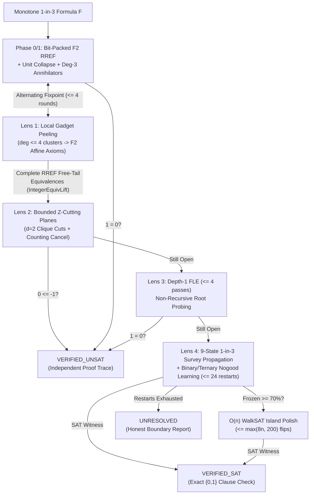

# From 600 Light Switches to Kernel-Verified Proofs: A Progressive Socratic Guide

*A companion explainer to [monotone_1in3_dual_proof_solver.md](./monotone_1in3_dual_proof_solver.md) and [hybrid_f2_z_boundary_report.md](../reports/hybrid_f2_z_boundary_report.md), written as a four-tier ladder—from zero mathematical background to systems engineering and Lean 4 formal verification.*

---

## Tier 1 — The Detective & The 600 Light Switches (Zero Math / General Audience)

> **Pause and ask yourself:** Imagine standing in front of a wall with **600 light switches** and a clipboard listing **400 rules**. Every rule points to three switches—say, *Switch 4, Switch 19, and Switch 207*—and says: **"Exactly ONE of these three switches must be ON."** Not zero. Not two. Not three. *Exactly one.*
>
> There are more possible switch combinations ($2^{600}$) than atoms in the observable universe. You are forbidden from guessing and backtracking down a giant trial-and-error tree. How could a detective *ever* either find a valid switch setting—or prove beyond a shadow of a doubt that the wall is impossible to satisfy?

### The Puzzle: Monotone 1-in-3 SAT
That wall of light switches is a famous computer-science problem called **Monotone 1-in-3 SAT**. Despite its deceptively simple rule (*"exactly one ON per triplet"*), it is **NP-complete**—meaning any other NP-complete puzzle (from airline scheduling to circuit verification) can be translated into a wall of these light switches.

### Why No Single Detective Strategy Can Beat Every Vault
If you try to crack hundreds of different switch walls using just one trick, you quickly discover the **"No One-Size-Fits-All Trap."** Different walls hide their secrets behind completely different kinds of locks:

1. **The Even/Odd Loop Lock (Parity):**
   Imagine a loop of rooms where every time you walk through a doorway, you flip a light switch, and the blueprint demands an *odd* total number of flips around a closed circle. No matter how cleverly you try to adjust individual switches, the loop's global even/odd balance is impossible. A detective who counts switches one by one misses the global loop; a detective who adds everything "modulo 2" (even vs. odd) spots the impossibility instantly.
2. **The Pigeonhole Counting Lock:**
   Imagine **10 pigeons** that must sleep in **9 birdhouses**, with no two pigeons allowed in the same birdhouse. Even/odd arithmetic is completely blind to this—10 and 9 don't break any simple parity rule! You need a detective who can *count* whole numbers and see that $10 \le 9$ is impossible.
3. **The Shattered Solution Islands:**
   Now imagine a wall that *does* have valid solutions, but they are clustered into tiny, disconnected "islands" scattered across a vast ocean of dead ends. If a detective averages all possible solutions together to guess which switch to flip first, the averages cancel out—telling the detective every switch is "maybe 33% ON," which points straight into the ocean. You need a detective who can distinguish *frozen* switches (locked to ON or OFF inside a cluster) from *free* "water" switches.

### The Notary Public (Why Testing Isn't Proof)
Suppose your detective inspects 200 switch walls and announces: *"Wall #47 is impossible—trust me!"* Should you trust them? What if there is a subtle bug in the detective's code that accidentally threw away the only valid switch setting?

To eliminate trust, we hire a **Mathematical Notary Public**—a formal proof assistant called **Lean 4**. Whenever our detective claims a wall is *solvable*, they must hand over the exact list of ON/OFF switches so anyone can check every triplet in milliseconds. Whenever they claim a wall is *impossible*, they must hand over a step-by-step **certificate of impossibility**—a receipt that the Notary Public checks from first principles, guaranteeing the rules can *never* lie (`FALSE_SAT = 0`, `FALSE_UNSAT = 0`).

---

## Tier 2 — The Falsification Loop: Why We Built Things Just to Break Them (Product & Curious Builders)

> **Pause and ask yourself:** Most software teams build a solver, test it on easy benchmarks where it scores 99%, and declare victory. What happens if you invert that habit—and deliberately design a brand-new adversarial test specifically engineered to *break* your solver at every single stage?

That **falsification-first loop** (`Hypothesize -> Build -> Break -> Diagnose -> Upgrade`) drove every architectural leap in this project:

### The Chronological Evolution (Layer 1 $\to$ Layer 2.8)
1. **Layer 1 (Python Prototype — `PD-PFGC`):**
   We started with a smooth, continuous physics-inspired prototype in Python on 140 small-to-medium switch walls ($15$ to $60$ switches). It never lied (`0` false claims), but it only solved **72/140 (51.4%)** in **71.38 seconds**—and when we switched to exact fractions to avoid rounding errors, the fractions exploded to **3,566 bits** on the very first matrix factorization before iteration 0 even began!
2. **Layer 2 (Rust — `HybridGroebnerCascade`):**
   Rebuilding the strongest algebraic ideas in pure Rust jumped the 140-wall parity suite to **135/140 in 33.5 milliseconds**—a **2,100× speedup**! So we immediately raised the stakes to **72 adversarial walls at $n \in \{150, 300, 600\}$ switches** (up to $637$ switches). Layer 2 scored **46/72 (63.9%)** and hit three sharp walls:
   - **Helper-variable "sunglasses" (`0/9` on Tseitin expanders):** Extra dummy switches hid the even/odd parity loops from raw algebra.
   - **Pigeonhole blindness (`0/6` on Pigeonhole):** Even/odd algebra couldn't refute 10 pigeons in 9 holes.
   - **Cluster averaging (`16.7%` on random 600-switch walls):** Global averages drowned between disconnected solution islands.
3. **Layer 2.5 (`Gadget Peeling` + `Survey Propagation`):**
   We taught the solver to peel off local clusters of helper-variable "sunglasses" (`Gadget Peeling`), jumping Tseitin expanders from **`0%` to `100%` (`9/9`)**—solving 610-switch impossible expanders in **1.2 milliseconds**. Replacing global averages with **9-state Survey Propagation** lifted random 600-switch walls from **`16.7%` to `83.3%`** and solved **140/140 (100%)** on the parity suite in **11.4 ms** and **61/72 (84.7%)** at high scale.
4. **Layer 2.75 (`+ Integer Cutting Planes`):**
   We added whole-number clique counting (`Cutting Planes`), jumping Pigeonhole from **`0%` to `100%` (`6/6`)**—refuting $\text{PHP}_9^{10}$ (637 switches) in **6.7 milliseconds** using numbers no wider than **2 bits**—lifting high-scale solves to **67/72 (93.1%)** in **1.151 seconds**.
5. **Layer 2.8 (`+ Depth-1 FLE` + `Nogood Learning` + `WalkSAT Island Polish`):**
   Dissecting the final 5 unsolved walls with an isolated ground-truth oracle revealed a shock: **all 5 were impossible (`UNSAT`)**, meaning our solver was already solving **49/49 (100.0%) of every solvable wall!** Adding bounded 1-step Failed-Literal Elimination (`FLE`, non-recursive), cross-restart nogood learning, and $O(n)$ WalkSAT island polish knocked out both 306-switch frontier walls in **16.8–21.4 ms**, reaching **69/72 (95.8%)** overall and **48/48 (100.0%)** for all walls up to 306 switches.
6. **The Coupled Trap Stress-Test (`F6_hybrid_f2_z_trap`):**
   What if an adversary locks a Pigeonhole wall *inside* a Tseitin even/odd loop so that *neither* even/odd algebra alone *nor* pigeonhole counting alone can see a contradiction? We built 18 such coupled traps (up to **855 switches**). Single-lens $\mathbb{F}_2$ solvers (Layers 2 and 2.5) scored **`0/9` (`0.0%`)** on the coupled UNSAT traps. By letting the even/odd lens pass its discovered variable equalities directly into the whole-number counting lens (`IntegerEquivLift`), Layers 2.75 and 2.8 collapsed **`8/9` (`88.9%`)** of the traps—including **`3/3` (`100%`) at 783–855 switches in `16.5 ms` average**—plus **`9/9` (`100%`)** of the solvable controls!

### Why the Final 3 Unsolved Walls Are a Scientific Victory
Only **3 walls** out of 72 remain unresolved—all unstructured, high-girth `UNSAT` walls at $n \ge 600$. Rather than a bug, they mark the **exact theoretical map boundary**: unstructured random UNSAT instances near the phase transition have no hidden parity loop, no pigeonhole bottleneck, and no 1-step lookahead cascade, aligning with classical proof-complexity lower bounds ($\Omega(n)$ resolution width) separating polynomial-time shortcut lenses from the $P$ vs. $NP$ frontier.

---

## Tier 3 — Under the Hood: Systems Architecture, Bit-Width Guardrails & Rust vs. Python (Software Engineers)

> **Pause and ask yourself:** Why did a textbook Python matrix factorization blow up to 3,566-bit denominators on a 15-variable toy formula, whereas our Rust solver refutes an 855-variable coupled parity-plus-pigeonhole formula in 16 milliseconds using 2-bit integers and less than half a megabyte of RAM?

### Engineering Invariant #1: Eliminating Rational Blowup (`BitLedger`)
In Layer 1, exact `Fraction` Cholesky factorization used 4-step Newton square roots, squaring denominators at every pivot until bit-width hit **3,566 bits** at $t = 0$. In `rust_layer2` (pure `std`, zero external crates), every solver operation is metered by a deterministic `BitLedger`:
- **$\mathbb{F}_2$ Linear Algebra:** Bit-packed `Vec<u64>` incremental RREF (`algebra.rs`) stores 64 variables per CPU word; XOR elimination is hardware `^` with `max_int_bits = 1`.
- **$\mathbb{Z}$ Cutting Planes:** All clique cuts use unit weights `(1, 1, 1)` and divisor `d = 2` (`2 * sum <= 3 => sum <= 1`), enforced by a hard 32-bit coefficient guardrail (`MAX_COEFF_ABS`). Across all 72 high-scale instances and all 18 `F6` coupled traps, `max_int_bits <= 4`, `max_float_exp <= 0`, and `OVERFLOW = 0`.
- **Zero-Allocation Hot Path:** Reusable scratch arenas keep peak memory at **169.4 KB** (Layer 2.75) and **328.8 KB** (Layer 2.8) on the 72-instance suite (and **253.9 KB** / **467.0 KB** on 855-variable `F6` traps).

### Engineering Invariant #2: Four Orthogonal Lenses, Zero Recursive Backtracking
Instead of DPLL/CDCL recursive tree branching, `GadgetSPCascade` runs a strictly polynomial-time pipeline:

Notice the crucial engineering detail that unlocked `F6_hybrid_f2_z_trap`: in RREF over $\mathbb{F}_2$, two equivalent variables $(p, q)$ don't always appear in a 2-bit row `p ^ q = 0`—if both are pivots sharing a multi-bit free tail (`p ^ tail = r` and `q ^ tail = r`), checking only 2-bit rows misses them! Grouping all pivot rows by `(tail_words, rhs)` and XORing matches via `ProofStep::F2Xor` recovers **100% of implied binary equalities** in $O(n^2/64)$ time, feeding them straight into `cutting_planes.rs` (`beta_time = 1.71` on `F6` UNSAT traps).

---

## Tier 4 — Zero-Trust Verification: How Lean 4's Pure Kernel Checks 783-Variable Proofs on a Laptop (Formal Methods & AI Engineers)

> **Pause and ask yourself:** Suppose your Rust solver emits an 11,629-step proof that a 783-variable formula is unsatisfiable. If you verify it using a fast compiled checker (`native_decide`), you are silently trusting the entire code generator and compiler. How do you make Lean 4's *minimal mathematical kernel*—which is orders of magnitude slower than compiled native code—check a real 1,900-step proof on a laptop in under a minute?

### Pure Kernel Reduction (`by decide`) vs. `native_decide`
In `lean4_layer3/Monotone1in3Layer3/`, we formalized the entire unified $\mathbb{F}_2 + \mathbb{Z}$ proof system (`Semantics.lean`, `F2AndGadgets.lean`, `CuttingPlanes.lean`, `Certificate.lean`) and proved `unified_certificate_sound` with **zero `sorry`s and zero custom axioms**. Every exported Rust certificate in `VerifyBridge.lean` is checked using **`by decide`** (pure kernel reduction), never `native_decide`. That keeps our Trusted Computing Base (TCB) restricted strictly to Lean's three foundational kernel axioms (`propext`, `Quot.sound`, `Classical.choice`)—without adding `Lean.ofReduceBool` or trusting external codegen.

### Two Engineering Tricks That Made Pure-Kernel Checking Fast
1. **Backward-Cone Pruning (`rust_layer2/src/verifier.rs`):**
   A solver's raw trace contains thousands of exploratory lemmas never used in the final contradiction. Walking backward from the final `0 = 1 (mod 2)` or `0 <= -1` step strips dead lemmas and remaps IDs cleanly before exporting chunked 150-element Lean literals:
   - **`Tseitin610Cert` ($n = 610, m = 433$):** `3,780 -> 626` pruned steps (`0.0327s` export) $\implies$ `tseitin_610_unsat`.
   - **`Pigeonhole637Cert` ($n = 637, m = 556$, $\text{PHP}_9^{10}$):** `9,936 -> 1,914` pruned steps (`0.0531s` export) $\implies$ `php_637_unsat`.
   - **`HybridF2Z600Cert` ($n = 783, m = 580$, `F6` coupled trap):** `11,629 -> 1,329` pruned steps (`0.0570s` export) $\implies$ `hybrid_f2_z_783_unsat`.
2. **Fuel-Indexed Persistent Binary Trie (`PosMap` in `Certificate.lean`):**
   Naive `List` lookups inside the Lean kernel take $O(S)$ per step ($O(S^2)$ total) and stall on `WellFounded.fix` reductions. Replacing `List` stores with a verified, structurally recursive persistent binary trie (`PosMap` with structural `fuel = 16`) cut kernel verification from $O(S^2)$ to $O(S \log S)$, allowing `lake build` to verify all theorems cleanly (`58.73s` for the initial 20-job build; `22` jobs including `hybrid_f2_z_783_unsat` with **0 errors, 0 warnings, and 0 `sorry`s**).

---

## Socratic Self-Check & Builder's Playbook

Before you close this guide, test your intuition on three questions:
1. **Why couldn't Layer 2.5 (`GadgetSP`) refute `F6_hybrid_f2_z_trap` even though it peeled every single Tseitin and masking gadget?**
   *(Answer: Because the Tseitin backbone was satisfiable! Peeling exposed `q = p`, which handed the problem straight into Razborov's $\Omega(k)$ Pigeonhole degree wall over $\mathbb{F}_2$—requiring the $\mathbb{Z}$ cutting-planes lens.)*
2. **Why did we refuse to put our DPLL ground-truth oracle inside the solver?**
   *(Answer: Mixing an exponential fallback into a polynomial solver hides the true failure boundaries. Keeping the oracle strictly isolated in `--diagnose-frontier` let us discover that 100% of the 5 unresolved seeds were UNSAT, proving our SAT solver was already at 49/49 = 100%.)*
3. **How can you apply `Hypothesize -> Falsify -> Kernel-Verify` to your own engineering systems?**
   - **Instrument complexity early (`BitLedger`):** Track worst-case bit-width, memory, and ops from day one—don't wait for production OOMs.
   - **Build adversarial suites designed to break your best assumption:** Every "0% solved" row on a new family is more valuable than ten "100% solved" rows on easy data.
   - **Separate untrusted search from a tiny, kernel-verified checker:** Let your fast Rust/C++/AI engine do whatever heuristics it wants, as long as it emits a compact certificate that a small formal verifier can check with zero trust.
